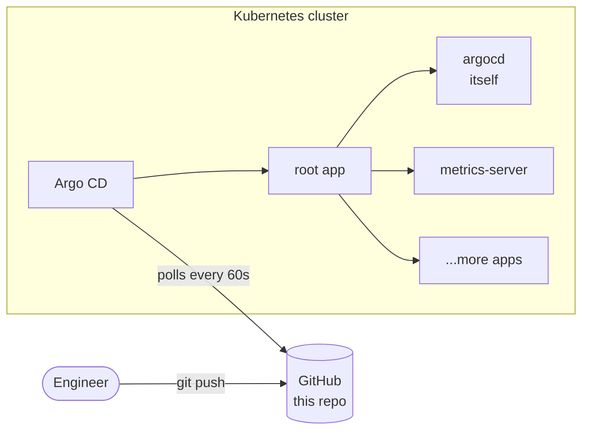

# k8s-gitops-platform

[](https://github.com/ZarthVazer/k8s-gitops-platform/actions/workflows/ci.yml)


A Kubernetes platform managed entirely through Git with **Argo CD**. After one bootstrap command the cluster configures itself from this repository: every change is a commit, every rollback is a `git revert`.

Every commit is tested **end-to-end**: CI creates a real Kubernetes cluster with kind, installs Argo CD and waits until the whole platform is synced and healthy.

> 🚧 **Work in progress**
> - [x] Argo CD, self-managed, app-of-apps
> - [x] metrics-server
> - [x] CI: YAML lint, schema validation, end-to-end test on kind
> - [ ] Gateway API ingress (Envoy Gateway) and the `cicd-pipeline-demo` app deployed via GitOps
> - [ ] Secrets in Git with Sealed Secrets
> - [ ] HTTPS with cert-manager

## How it works



1. `scripts/bootstrap.sh` installs Argo CD and creates one object by hand: the **root** application.
2. The root app points at [`apps/`](apps/). Every file there is another Argo CD `Application`.
3. Argo CD creates those applications, and each of them syncs its own part of the platform.
4. **Argo CD manages itself** too: upgrading it means changing one version number in a pull request.

Sync waves (`argocd.argoproj.io/sync-wave`) control the order: Argo CD itself first, then platform components, then workloads. A custom health check in `argocd-cm` makes the root app wait until each child app is healthy before starting the next wave.

## Repository layout

```
.
├── bootstrap/
│   ├── argocd/            # Argo CD install (pinned upstream manifest + config patches)
│   └── root-app.yaml      # the only thing applied by hand
├── apps/                  # one Argo CD Application per component (app-of-apps)
├── platform/              # cluster components: metrics-server, ...
├── scripts/               # bootstrap and CI helpers
└── .github/workflows/     # validation + end-to-end test on kind
```

## Run it locally

Requirements: a Kubernetes cluster (Docker Desktop with Kubernetes enabled, or `make cluster` for kind) and `kubectl`.

```bash
make bootstrap     # install Argo CD and hand the cluster over to Git
make status        # watch applications become Synced / Healthy
make password      # initial admin password
make ui            # Argo CD UI on http://localhost:8080 (user: admin)
```

## Design decisions

**App-of-apps instead of clicking in the UI.** Nothing is created by hand except the root application, so the cluster can be rebuilt from scratch with one command and Git is the single source of truth.

**Pinned upstream manifests, no copy-paste.** Components are installed from their official release manifests at an exact version through Kustomize, with small patches on top. Upgrading is a one-line diff that is easy to review.

**Self-healing and pruning.** `selfHeal` reverts manual `kubectl edit` changes; `prune` deletes resources that were removed from Git. The Argo CD app itself has pruning disabled so it can never delete parts of itself.

**Tested like code.** Each commit is linted (yamllint, shellcheck), every Kustomize build is validated against Kubernetes schemas (kubeconform), and an end-to-end job bootstraps the platform on a throwaway kind cluster. CI pins the applications to the commit under test, so a broken change is caught before it reaches `main`.

## License

MIT
